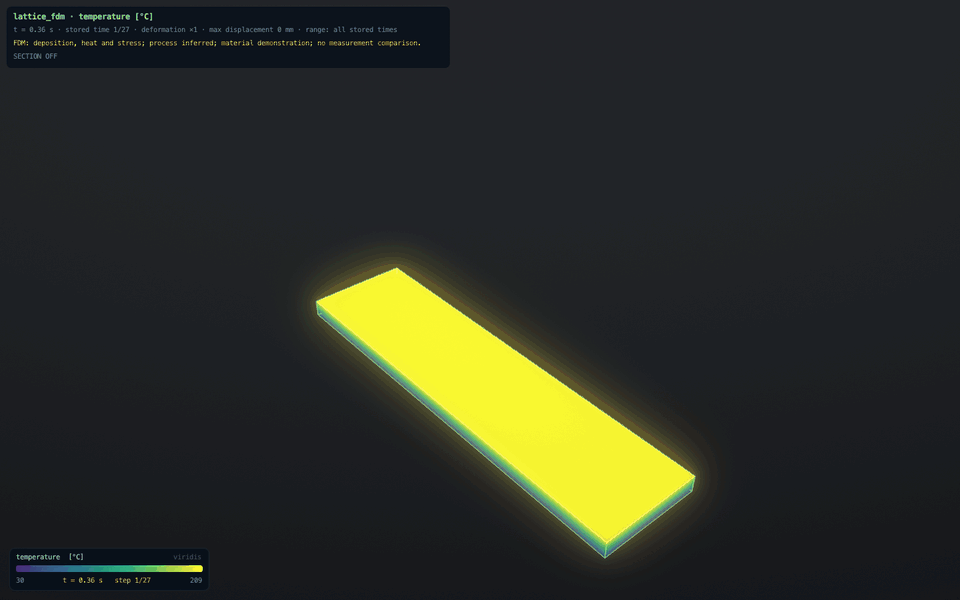

# Structural and thermal analysis

How OpenPhysicsAI turns an STL file into a verified analysis - linear-elastic statics, transient conduction, or the two
coupled - what every step assumes, and what the files in a run directory contain. Every step is an operation of the
control API (terminal `am`, control socket, MCP tool, or a button in the application's SOLID workspace).

## Workflow

To compare two to four designs of a part under equivalent mounting and load (mesh refinement, sensitivities and an
Engineering Evidence Record), use the comparison-study operations `study_check`, `study_run`, `study_evidence` and
`study_replay`, or `openphysics-ctl study ...`: see `docs/release/WORKFLOW.md`. The table below lists the detailed operations
those studies compose.

| Step | Operation | Produces |
|---|---|---|
| Import | `geometry_import` (units required), `geometry_place`, `geometry_diagnostics` | body in the build frame, repair and thickness report |
| Faces | `surfaces_list`, `view_render`, `view_pick` | face patches with area, normal, type; labelled images with cameras |
| Selections | `selection_create`, `selection_list`, `selection_preview`, `selection_delete` | named face sets with SHA-256 set hashes |
| Material | `materials_list`, `material_list`, `material_define`, `material_assign` | material records with status and provenance; `material_list` gives every record at a glance with what it lacks for a stress or a heat analysis |
| Mesh | `mesh_generate`, `mesh_inspect` | voxel hex8 mesh with approximation errors |
| Loads | `boundary_apply`, `boundary_list`, `boundary_remove` | supports and loads bound to selection hashes |
| Check | `setup_validate` | errors with hints, warnings, model summary, specification hash |
| Solve | `analysis_run` (`static_structural`, `transient_thermal`, `thermomechanical`), `job_status`, `job_cancel`, `job_list` | background job, run directory |
| Results | `results_query`, `results_probe`, `results_render`, `results_export` | statistics, point values, images, files |

Coordinates are in the build frame (right-handed, +z build direction, z = 0 on the plate top) in mm; stresses in MPa;
forces in N. Internally everything is SI and double precision.

## Mesh

`mesh_generate` samples all part and support bodies on a regular grid aligned with the build frame and keeps the
cells whose centres lie inside the closed STL surface. All elements are undistorted boxes (positive, constant
Jacobian), which also makes element layers line up with deposited layers. The price is a staircase boundary. The
response reports, per body, mesh and STL volume and area, the mean and largest distance from boundary faces to the
STL, face-connected regions, edge-only contacts, walls thinner than two elements (when `geometry_diagnostics` has
measured thickness) and how many mesh faces carry each selection. Omitting the element size rebuilds the stored
settings of a reopened project and reports whether the mesh hash is reproduced; with no stored settings an automatic
size is chosen and reported. Confirm results by halving the element size.

## Materials

Library entries (`src/ctl/materials.json`) are demonstration values: typical magnitudes that let workflows run,
not traceable to a grade, supplier or test, and not calibrated. Project materials (`material_define`) carry a status
(`user_supplied`, `calibrated`, `demonstration`) and a provenance text. Properties are SI values named by their key
(`youngs_modulus_pa`, `poisson_ratio`, `density_kg_m3`, ...), either constants or temperature tables in degC,
interpolated linearly and held constant outside the table. Values outside plausible ranges (for example a modulus
typed in GPa as Pa) are rejected. The static analysis evaluates properties at `reference_temperature` (default 20 degC).

## Printed parts: will it break? (GOALS.md G17)

A 3D-printed plastic part is stiffer and stronger along its layers than between them. `analysis_run` takes a
printed-material model and solves the part as a homogenised orthotropic solid (`src/mech/ortho.h`) with the project's
own supports and loads, element formulation and solver:

    mech_material_define {"material": {"id": "my_pla", "model": "orthotropic",
        "elastic": {"E1": "3.2 GPa", "E2": "3.2 GPa", "E3": "2.6 GPa", "nu12": 0.35, "nu13": 0.32, "nu23": 0.32,
                    "G12": "1.19 GPa", "G23": "1.1 GPa", "G13": "1.1 GPa", "source": "datasheet", "reference": "..."},
        "strength": {"Xt": "50 MPa", "Xc": "60 MPa", "Yt": "50 MPa", "Yc": "60 MPa", "Zt": "30 MPa", "Zc": "55 MPa",
                     "S12": "30 MPa", "S23": "25 MPa", "S31": "25 MPa", "source": "datasheet", "reference": "..."}}}
    analysis_run {"material_model": {"type": "orthotropic", "material": "my_pla", "build_direction": "z",
                                     "raster_reference": "x", "raster_angle": "0 deg", "criterion": "tsai_wu"}}

Axis 3 is the build direction (normal to the layers); axes 1 and 2 lie in the layer plane, axis 1 along the raster
reference rotated by the raster angle. The numbers above are an illustration, not data: every value needs its source,
and none is supplied by default.

Or take a library material: `"material_model": {"type": "orthotropic", "library": "petg_fff"}`. Nine library records
(PLA, ABS, ASA, PETG, PC, PA6/66, PA6-CF, PA12, ULTEM 9085) carry Young's modulus and tensile strength along the layers
and across them, each pair read from one supplier sheet ([materials/batch2-sources.md](../materials/batch2-sources.md)).
What no document gives follows from rules that every result repeats in its assumptions: E1 = E2 along the layers and E3
across them (an isotropic layer plane, as for a +-45 degree raster); Poisson's ratios equal to the record's or 0.35,
assumed; G12 = E1 / (2 (1 + nu)) and G13 = G23 = E1 E3 / (E1 + E3 + 2 nu E3) (Saint-Venant's approximation);
compressive strengths equal to the tensile ones; shear strengths S12 = Xt / sqrt(3) and S23 = S31 = Zt / sqrt(3). The criterion is `max_stress`, `tsai_hill` or `tsai_wu` (the default, interaction
coefficients -1/2 unless given). Tsai-Hill takes each normal stress's tensile or compressive strength by its sign; in
the interaction term of two stresses the third axis enters with the geometric mean of its two strengths, so that a
stress of zero never switches it (with equal tension and compression strengths it is the usual 3D Tsai-Hill). Like
every pressure-independent quadratic form it couples in-layer stresses through the interlayer strength; Tsai-Wu and
maximum stress do not.

The job summary gains `strength`: the criterion, the largest failure index (1 = the criterion is reached), the smallest
strength ratio (the factor on all the loads at which it is first reached), the governing mode (for example `3t
(interlayer tension)`), the governing element and point in mm, the stress there in material axes, the sources of the
constants and the assumptions. The results file keeps the failure index and the governing mode at every Gauss point
(`gp_index`, `gp_mode`) and, per node, the largest index of the elements around it (`node_index`), which the
application draws as the FAILURE INDEX field (`fem field failure_index`) and the headset shows through the same
export. Read it as what it is: a linear-elastic first-failure estimate for non-critical parts, not a guarantee; it
inherits the uncertainty of the strengths and of a homogenised solid without voids or layer-scale defects. Comparison
with measured breaks (step 5) comes next. The verification is `tools/printstrengthtest.c` and
`tools/printstrength_app.py` (`make test-print-fast`, under Verification below).

**The break estimate (GOALS.md G20 step 5).** A plastic bent to breaking carries more than its first failure says:
its outer fibres flow at their strength while the fibres inside take up load, and printed PLA and ABS are stronger in
compression than in tension. Beside the first-failure ratio the answer gives `break_estimate`: through the wall at the
stated point, along the direction in which the governing stress falls fastest, the stress is interpolated in the
elements and split into its membrane and bending parts (ASME VIII Division 2 Annex 5-A), and the section's break
factor follows from a material elastic up to its tensile strength, flowing at it in tension and at c times it in
compression, which breaks when its outer tensile fibre reaches m times the elastic limit strain (`src/mech/breakest.c`,
`src/mech/breakest_fe.c`). c (1.24 for PLA and its blends, 1.88 for ABS and ASA, 1.64 otherwise) and m (1.75) were fixed
on nine calibration studies only; blind, the estimate met 21 groups of six other studies within a median 12.9 % and the
26 published groups of G17 step 5 within 16.7 % (the first-failure estimate: 41.7 %). It is evaluated for a solid part
whose governing stress is a tension along a material axis; with walls and infill, or a shear or compression mode, the
field says why it is not. Its verification is `tools/breaktest.c` (closed forms) and checks e and f of
`tools/printstrengthtest.c` (a cantilever's section against beam theory: upright +0.06 %; flat -3.34 %, open against
its 3 % and pinned at 4 %).

**Walls and infill (G17 step 3).** A printed part is solid walls around a lighter core. Give the slicer's settings
and the part is solved that way:

    "material_model": {"type": "orthotropic", "library": "pla_fff", "build_direction": "z",
        "walls": {"perimeters": 2, "line_width": "0.45 mm", "top_layers": 4, "bottom_layers": 3, "layer_height": "0.2 mm"},
        "infill": {"density": "20 %", "pattern": "gyroid"}}

The walls are the printed material within perimeters x line width of the side faces and top (bottom) layers x layer
height of the faces that look up (down), measured along the voxel grid's axes from the part's boundary: exact for faces
along the axes, thinner than printed on slanted ones, so the build direction must be x, y or z. An element the wall
boundary cuts mixes wall and core at equal strain, and wall and core are each checked against their own strengths at
that strain; the summary's `governing_part` says which one fails first, and `walls_and_infill` gives the wall
thicknesses, the element counts, the wall volume fraction and the core's constants and strengths.

The core is modelled for gyroid only. Its stiffness follows Bean, Lopez-Anido and Vel, "Numerical Modeling and
Experimental Investigation of Effective Elastic Properties of the 3D Printed Gyroid Infill", Applied Sciences 12:2180
(2022, CC BY 4.0): closed forms fitted to periodic finite-element models of the slicer's gyroid, E/Em = D - (1 - D)^0.77
D^1.2 (within 1.13 % of their models; 0.078 at 20 %, 0.245 at 50 %), with their shear modulus and Poisson's ratio. The
slicer's infill percentage is taken as the solid fraction D, and each constant of the printed road is scaled by the
same functions (they were fitted for an isotropic road). Its strengths are the printed material's times the smaller of
the modulus fraction and the yield fraction measured on printed gyroid infill of PA6-CF compressed along the build
direction from 10 to 30 % (Lambiase, Pace and Andreucci, Int J Adv Manuf Technol 145:745-769, 2026, CC BY 4.0, their
Table 6: 5.32 D^2.72), and the modulus fraction alone above 30 %, where it lies below that law: 0.067 at 20 %, 0.245 at
50 %. These are rules of the model, repeated in every result, not measurements of your print; step 5's breaks test
them. Below 10 % a strength is refused, and so are grid, lines and triangles: no published model was found that covers
them from 20 to 100 %. At 100 % the core is the printed material itself.

**The answer (G17 step 4, 2026-10-08).** The smallest strength ratio of one Gauss point is not an answer: at a sharp
inside corner it falls by a quarter each time the elements are halved (the sample bracket: 2.92, 2.16, 1.63 at 1, 0.5
and 0.25 mm), because a perfectly sharp corner or the edge of a rigid support has no finite stress in a linear model.
So `strength` also states a ratio: the smallest at the part's nodes (the surface stress, extrapolated from the Gauss
points and averaged) outside max(1 mm, 1.5 element sizes) of the part's sharp inside corners (STL edges folding inward
by more than 30 degrees) and of the nodes a fixed support or a prescribed displacement holds (`stated_strength_ratio`,
`stated_location_mm`, `stated_governing_mode`); a frictionless support, how a symmetry plane is modelled, is no
singularity. The peak inside a zone is flagged (`peak_flag`: `sharp_inside_corner` or `support`) and not stated. The
bracket's stated ratio then moves by 1.1 % from 0.5 to 0.25 mm voxels and 1.5 % from 0.7 to 0.5 mm TET10, and the two
meshes agree within 0.7 % (3.04 and 3.02; `tools/printmesh_study.py`). `strength.answer.text` says it in words: how
many times the entered load the part holds (in kilograms when one force was entered), where and whether between the
layers or along them, what a flag means (at a sharp corner: that the corner itself will hold less than the number
stated, and must be rounded and run again), and the inputs' provenance (`answer.sources`: the material record, the
sources of its elastic constants and strengths, and every support and load with who set it); the RESULTS panel shows it
before the numbers. With `"compare_orientations": true` the job also solves the part with each principal axis of the
build frame as its build direction (two more solves; the placed one is reused) and names the strongest: the sample bracket printed on its side holds about 1.3
times as much as printed flat. With walls and infill the stated ratio is read at the Gauss points instead, where walls
and core are each checked against their own strengths (`stated_part` says which), and the comparison lays the walls out
again for each build direction; walls and infill need the voxel mesh, and a TET10 mesh with them is refused.

A printed part can now be solved on a TET10 mesh (`mesh_generate` method `tet`, order 2), which follows the surface;
with equal constants it is the isotropic tetrahedral solver to 4e-13. Since the tetrahedral mesher keeps sharp edges
(2026-10-08, GOALS.md G20 step 5) a C-ring's stated ratio is within 1.0 % of the curved-beam closed form on TET10, as
CalculiX on a structured C3D20R mesh of the same ring is (`tools/printmesh_ccx.py`), and the peak at a hole's edge
within 0.5 % of Heywood (`tools/hole_plate.py`); before it, a local peak where a curved surface met a flat face read
12 % under on the ring. On voxels a curved or inclined surface is a staircase whose steps distort the stress at every
element size: on the C-ring of `tools/printmesh_study.py` the stated ratio is 13.6 to 23.8 % under the closed form
(apex on a 45-degree staircase or along a grid axis, 0.5 and 0.25 mm), on the plate with a hole of `tools/printhole.py`
5.4 and 13.0 % under Heywood, and on the L of `printstrengthtest` with a 5 mm fillet (1.25 mm voxels) 18 % above what
TET10 states at the same size (GOALS.md G17 steps 8 and 9). So since 2026-10-08 a printed answer without walls and
infill, asked on a voxel mesh of a part with surfaces inclined to the grid, is solved on TET10: `analysis_run` first
meshes the part as `mesh_generate` with method `tet` and order 2 would, at the voxel size within 150 000 elements (the
size growing by half again when the mesher refuses that many), the project keeps that mesh, and the response's
`mesh_choice` says what was done and why. Twice the voxel size was tried first: it costs about what the voxels cost,
but left a coarse edge's peak 12 % low on a ring and moved a 5 mm fillet by 8 %. The edge peaks were the mesher's, a
notch or a cut-off corner where a curved face meets a flat one, and are closed since the same day
([tet-mesh.md](contracts/tet-mesh.md) section 13): the ring and the plate with a hole now read within 1.2 % at every
size tried. A fillet only a few surface cells across still moves with the size, so check a stress there with half the
surface size. `"mesh": "as_meshed"` in
`material_model` keeps the voxels; walls and infill are laid out on voxels only and keep them too. Where the stated
point then stands at a staircase, the answer says so (`strength.stated_near_staircase` and a sentence in
`answer.text`). A reading of the stress beneath the steps was tried for the voxel answer and withdrawn: within a few
per cent where the voxels resolve the feature (the C-ring at 0.25 mm), but low, the unsafe side, on coarser meshes
(the hole 17 % at 0.5 mm); GOALS.md G17 step 8 has the runs.

**Against published breaks (2026-10-08).** Before the owner breaks parts (G17 step 5), the model was compared blind
with 26 groups of published tests of printed plastics: the NCAMP qualification of ULTEM 9085 (open-hole tension and
bending in three orientations, tension at 45 degrees to the layers), Gomez-Gras et al. 2021 (PC-ISO bending, three
orientations and three rasters) and Caminero et al. 2019 (three PLA filaments in bending, three orientations).
`tools/publishedbreaks.py` built each prediction from the study's own tensile coupons alone and froze it with its SHA-256
before the outcomes, sealed outside the repository, were opened. The median absolute error is 42 %, against step 5's
bar of 25 %, and 25 of the 26 predictions lie under the measured strength: bending by a median 40 % with the stress
along the layers and 42 % across them, open-hole tension by 55 to 76 %, while tension at 45 degrees to the layers is the
one above it, by 9 %. The model predicts the first
failure of a linear-elastic solid; these plastics yield before they break, so in bending the section carries more than
its first-failing fibre and around a hole the plastic spreads the load. Read `holds about R times` accordingly: on
these tests the parts held a median 1.7 times the estimate, and not always more. The scores, the diagnostic and what
comes next are in GOALS.md G17 step 5.

**Saying how it is used (G17 step 6).** In the window's Agentic mode a person opens a part, clicks on the faces that
matter and says how the part is used ("it is screwed to the wall here, and a 5 kg bag hangs here"). The question
names the clicked faces; the AI makes supports and loads of the words, the window colours them on the part (held
violet, loaded gold-brown) and shows them in plain words for **Run it** or **Not right** (`setup_confirm`), and only
then runs the analysis and says its answer. `tools/plain_setup.py` checks the path with a stand-in agent; whether
people without mechanical training get an answer alone is the owner's observation.

**Your own breaks (G17 step 5).** [validation/breaks/README.md](../validation/breaks/README.md) is the kit: parts to
print (tensile bars flat and upright, a hook, a bracket two ways, a beam at three infill levels, a slotted plate for the
rig), how to break them with a bucket of water and a luggage scale, and the record to write. `tools/breaks.py compare`
solves every record's part as it was printed and scores the model against it.

## Boundary conditions

| Kind | Meaning on the mesh |
|---|---|
| `fixed` | all displacement components of the selection's mesh nodes are zero |
| `displacement` | the given components (mm) are prescribed; omitted or null components stay free |
| `frictionless_support` | the normal component is zero; only flat faces normal to x, y or z (within 1 degree) |
| `force` | total force; uniform traction force / load area, integrated consistently over the mesh faces, so exactly the requested force is applied |
| `pressure` | traction -p n with the normal of the STL triangle behind each mesh face, scaled by STL area / load area, so the resultant equals the STL surface resultant on planar faces |
| `traction` | traction vector scaled by STL area / load area (resultant = traction x STL area) |

On a voxel mesh each face stands for its own area over the staircase factor |nx| + |ny| + |nz| of the STL triangle
behind it, because steps over a surface of unit normal n have that factor times its area (1 facing along a grid axis,
1.41 at 45 degrees, up to 1.73). A surface load acts on each face in that share, and the load area is the sum of those
shares: on a curved surface every face carries what its part of the surface carries, and on a flat face, where the
factor is one number, this is exactly the single STL area / mesh area ratio used before. Without it a ring under
internal pressure came out four-lobed (GOALS.md G22, `tools/ringloads.py`). On a tetrahedral mesh the faces lie on the
surface and carry the load over their own area (a force over their integrated area). The job summary reports each
load's mesh, STL and load areas.
| `gravity` | body force density x acceleration on every meshed element |

Constraints are eliminated from the system; no penalty springs or artificial stiffness are added. Two supports that
prescribe different values on shared faces are rejected (`CONFLICTING_BOUNDARY_CONDITIONS`); where their faces only
meet at an edge, the earlier condition is kept on the shared nodes and a warning is issued. Each condition stores the
hash of its selection: if the selection later resolves to other faces (geometry or placement changed, selection
redefined), validation reports `STALE_REFERENCE` instead of silently moving the load.

## Transient thermal and thermomechanical analyses

`analysis_run` with `analysis: "transient_thermal"` steps the conduction equation on the same mesh. `end_time` and
`time_step` are required; `theta` chooses backward Euler (1, the default) or Crank-Nicolson (0.5), `capacity` chooses
lumped or consistent, `initial_temperature` sets the starting field and `output_every` how often a time is stored.

Conditions (`boundary_apply`): `temperature` (prescribed), `heat_flux` (into the body, negative cools), `convection`
(`{coefficient, ambient}`, Newton cooling), `radiation` (`{emissivity, ambient}`, linearised by a Newton step about
the face-mean temperature, not by a fixed film coefficient), and `heat_source` (`power_density` over a whole body).
Material properties may be tables in temperature: k, cp and rho are re-evaluated by Picard iteration inside each
step, and latent heat is carried as an apparent capacity over the solidus-liquidus interval.

Each step is solved in correction form, so the linear-solver tolerance applies to the change over the step rather
than to the absolute temperature. The response reports the per-step energy balance - what went in through sources
and boundaries against what is stored - so a run can be checked without a reference solution.

`analysis: "thermomechanical"` additionally solves the structure at every stored time with the thermal strain
integrated from `stress_free_temperature` and the temperature-dependent modulus applied per element. The coupling is
sequential and one-way: the structure does not feed back into the temperature field, and without plasticity or
element activation this is **not** a residual-stress prediction - the thermal stresses vanish again when the part
returns to a uniform temperature.

Results are time-indexed: `results_query`, `results_probe` and `results_render` take a time (or a stored index),
`results_export` writes `results.nvt`, one VTU per stored time with a `.pvd` collection that carries the times, and
a CSV time series with the temperature range, the energies and, for a thermomechanical run, the mechanical peaks.

## In the application

Earlier interface review and design references are [`docs/app/REVIEW.md`](app/REVIEW.md) and
[`docs/app/DESIGN.md`](app/DESIGN.md). The current two-mode workflow is described below.

Use **SIMULATIONS** at the top left to change experiments. **Browse** contains every shipped lab scenario,
with search and physics filters, plus routes to the live flow tunnel, solid mechanics, heat transfer, LPBF and FDM.
**Saved** reopens this workspace's projects and computed lab results. A scenario without a cached result opens its
inputs first; **RUN SIMULATION** starts the calculation explicitly. Changing inputs affects the next run only.

The top-right **Manual / Agentic** switch preserves the current workspace and result. Manual has a scrolling
inspector; printing and thermal results have a persistent play, step, speed and time bar. Loading a result opens
its Results step. The SOLID inspector retains its six-step workflow and explicit LPBF and FDM/FFF choices.
Only fields present in the result are offered. **CLEAN VIEW** retains visible **SIMULATIONS** and **CONTROLS**
buttons; returning from the browser restores the presentation. `hud off` remains an unobstructed capture mode.

Agentic connects the user's external command-line agent to this window's engine through its private control socket.
It passes the question as `$OPENPHYSICS_PROMPT`, shows the agent's transcript and engine journal, and follows the jobs it
starts. Both modes operate on the same projects and results. Legacy Advanced/Agent command aliases remain accepted;
they do not add another physics engine. The retained library inputs and real keyboard playback/section paths are
checked by `python3 tools/uicheck.py --lab`.

CLEAN VIEW (`hud clean`, **CONTROLS** or H to restore the interface) gives the result the full viewport while retaining its field,
units, stored time, range policy, deformation scale, maximum displacement, section setting and model/provenance notice. Printing
examples say when inputs are inferred, material values are demonstrations, yielding is absent or no measurement
comparison was made. A polished image must not imply a more complete model than the one that computed it.

Compute the open-cell example, wait for the actual jobs, and capture its native views and every FDM stored state:

```bash
make
python3 tools/demo_printing.py --capture --film
```

The script saves inputs, summaries, native results, `capture.nav`, views and raw PNG frames below
`build/demo-printing`. It does not resolve individual deposited roads or a metal melt pool. The saved
[evidence record](media/foundation/evidence.json) includes exact inputs, model scope, hashes and playback timing.



This replay uses 27 computed states and one temperature range. Playback is accelerated, with a one-second final
hold; lighting and the neutral studio are presentation aids. [The clean FDM view](media/foundation/fdm-clean.png)
and [the metal section](media/foundation/lpbf-section.png) use the same renderer and visual language.
[Before](media/foundation/ui-before.png) and [after](media/foundation/ui-after.png) show the interface on the same
synthetic two-element fixture. [The old LPBF cut](media/foundation/lpbf-cut-before.png) and
[corrected cut](media/foundation/lpbf-cut-after.png) show why the visible FE boundary matters: the old STL spanned
material that the solver had removed.

The SOLID workspace (`W`, or the SOLID button) drives the same operations from the interface: import, element size
and GENERATE, a material, FIX BASE and the conditions list, the analysis kind and RUN ANALYSIS, then the result on
the model in the 3D view - the hex-mesh boundary, displaced by the chosen exaggeration and coloured by von Mises
stress, displacement magnitude or temperature with the shared colour map. The stored-time slider steps a transient
result; `fem range all` keeps one colour range over every stored time so the change is visible while stepping, and
`fem range step` rescales to the step being shown. Nothing in the panel bypasses the operation layer, and anything
that needs a number the user must choose (a force, a film coefficient) is prefilled in the terminal instead of being
invented.

The panel is six steps and only the step being worked on is open; a line under the strip says what to do next, and a
control that cannot be used yet says why when the pointer rests on it. There are two paths through the same six
steps, and PART asks which one: PART, MESH, MATERIAL, HOLD & LOAD, SOLVE, RESULTS for what the part carries in
service, or PART, MESH, MATERIAL, BUILD, RUN, RESULTS for what the printer does to it. PART takes a dropped or opened
STL, asks the one thing that is never guessed (the unit its numbers are in) and gives the geometry verdict in words.
MESH suggests an element size for about 20 000 elements, takes the size from a slider or typed in millimetres, and
reports the volume the staircase mesh costs against the STL. HOLD & LOAD works by clicking the part: the face under the cursor
lights up, a click collects it, shift-click drops it, and HOLD or LOAD (force typed in the panel, direction normal,
-normal or an axis) turns the picked faces into a condition. RESULTS carries the engineering summary - displacement
and where, peak stress with its singularity flag beside the 99th percentile to design with, safety factor against
yield shown only next to what the material values are worth, applied load against the reactions with the residual,
mass, and the mesh the numbers came from. CHECK MESH solves the same case again at 0.7 of the element size (capped
near 60 000 elements) and says how far the answer moved, with both changes below 5 % labelled a small change.
Two meshes show sensitivity, not an accuracy bound or proof of convergence. It compares static structural results
only: on any other result the button is dim, and a click on it leaves that reason beside the step and in `fem status`,
as a refusal from the engine does, until a static result is open (2026-10-07). REPORT writes
<project>/report/<date>-<time>/ - one folder per report, so a second report never overwrites the first - with the
summary, the setup, the checks, the mesh sensitivity and three images, and says what the numbers are not.

BUILD is the same six steps asked of the printer instead of the part, for the two job kinds the engine has. LPBF
METAL sets the build orientation (the machine axis the long side lay along), the simulation layer thickness, the
inherent strain (three numbers typed with the provenance the operation demands), the cut height, kerf and start along the part, and
the elastic constants, which default to the assigned material and can be typed for the material the build is really
for. FFF PLASTIC sets layer height, printed layer height, nozzle, bed and ambient temperatures and the deposition
rate, each with its unit. Nothing is guessed and nothing is sent without a provenance: the typed strain carries the
word chosen, and the cut carries "assumed" because no source states a cut height and kerf. RUN BUILD submits `lpbf_build_run` or `mech_print_run`
and the window follows its own job. RESULTS then reports the tip deflection on the plate, after the cut and the
springback (or, for a print, the warp after release), the peak stress before and after, and what the cut removed;
PLAY BUILD replays the stored times with the deformation at scale 1, so what is on screen is the distortion itself,
and AFTER THE CUT jumps to the released part. REPORT writes the build's own report: the answer, the strain and its
source, the cut and its provenance, the elastic constants actually used, the solver's equilibrium error, and what an
inherent-strain answer is not.

A surface that is not closed is meshed, not refused. The inside test casts one ray along each of x, y and z through
one sample point per cell, offset from the centre by an odd fraction of the cell so that a part modelled on the same
grid does not put its faces where the rays ask, and takes the majority. The offset is small, a few ten-thousandths of
a cell (since 2026-10-08, GOALS.md G22 step 5; it was a hundredth, which shifted every part by that much and meshed a
ring centred on a grid node out of round by micrometres, differently in each quarter of the grid): a body symmetric
about the grid now meshes symmetrically, and a face lying exactly on cell centres is still decided the same way. A ray whose crossing count is odd cannot have
started and ended outside the part, so it went through a hole or through a sheet of zero thickness: it abstains for
that column rather than voting wrongly, which is what keeps a gap from flipping everything behind it. Cells the
remaining rays disagree on are counted as uncertain and reported per mesh with the box they occupy, and the mesh is
refused above five per cent of the elements. A generalised winding number would answer the same question more
generally; it costs a solid angle over every facet for every cell, which on a 631 167 facet casting is out of reach
here, while three parity rays cost what the three jittered rays of the old single-axis test cost.

`geometry_repair` is the other half, and it changes the part, so it is never automatic: it keeps only the shell the
part is made of (walking manifold edges alone, so a sheet stitched on along non-manifold edges is seen for what it
is) and fills boundary loops up to a stated number of edges, with a provenance, because filling a hole invents
material. Every change is counted in the answer and repeated in the PART step, and the repaired surface is stored in
the project like any other input. REPAIR in PART runs it.

What is drawn is the part, not the mesh. The solver's domain is the voxel mesh, but the surface on screen is the
STL the engineer supplied: every one of its vertices is placed in the element that contains it and carries the
displacement and the field interpolated inside that element with the solver's own shape functions, so a chamfer is a
chamfer and a fillet is a fillet. A vertex outside the staircase, and the STL is up to about half an element outside
it, is snapped to the nearest point of the nearest element within two element sizes; the panel prints the largest
such distance, and a vertex further out than that is not drawn. Normals are the STL's own, averaged per vertex
except where a facet turns away from that average by more than 45 degrees, so creases stay sharp. The mapping is
built once per geometry and mesh (12 018 vertices onto 20 080 elements in 3 ms) and cached. SURFACE and VOXELS
switch between the part and the mesh the numbers came from (`fem surface on|off|toggle`), and a marker sits on the
largest value of what is drawn. Whenever any element is hidden by growth, a cut, a section, groups or topology, or
supports and a plate share the mesh, SURFACE draws the original STL split along the element grid (2026-10-06, the
owner asked for high-resolution results): every facet is cut by the grid planes into pieces that each lie in one cell,
and a piece is drawn when that cell's element is shown, so a long facet can never bridge absent material and the skin
ends on the same plane as the element face that closes the cut. Exposed element faces are drawn where the skin cannot
be: the faces a hidden part element used to cover, trimmed to the part's outline in 4 x 4 sub-squares tested against
the STL (so the cut-off base ends on the part's edge, not in element teeth), and every exposed face of supports and the
plate, which are not in the STL (the plate stays neutral grey). Faces next to a hidden support or plate outside the STL
are not drawn: the STL's own skin is there. The split is built once per geometry and mesh (the Helical Lantern: 61,440
facets into 176,956 pieces in 0.19 s); a frame only filters the pieces. An intact part-only result is split the same way
(since 2026-10-07: drawn on its own corners, a facet spanning many elements interpolates the field between them, and a
20-triangle bracket showed 26 % less than its largest failure index, GOALS.md G17 1d); its own facets remain the
fallback when the split cannot be built. VOXELS (`fem surface off`) still draws the mesh the numbers came from.

Rendering regression criteria (2026-10-03, declared before execution): a cube represented by only twelve STL facets
must use its finite-element boundary whenever birth, death, a section or a hidden group removes any element. The
intact six-cell cube remains twelve mapped facets; a one-cell interior cut has exactly 528 FE triangles, first-third
growth has 240, and a half section has 288. No filled STL facet or feature edge may span the removed material.
(Amended 2026-10-07, GOALS.md G17 1d: the intact cube is drawn as its split skin, 432 triangles closing exactly the
cube's 216 mm2, and a value at a node in the middle of a facet must be drawn; the twelve mapped facets hid it.)
(Amended 2026-10-06 in `tools/femviewtest.c` when the split skin was built, recorded here on 2026-10-07: a partly
shown state no longer falls back to the element boundary, so the triangle counts above became closure criteria. The
drawn area equals the shown solid's boundary within 0.5 % (cut layer 264 mm2, growth 120, half section 144, shown
support or plate 216, hidden support 192), and no drawn triangle lies over a hidden element.)
Native before/after captures of the same saved LPBF build must show a changed cut silhouette (at least 500 changed
pixels in the 3D view), while SURFACE and VOXELS show the same filled boundary at the released time. These are
presentation contract checks, not physical validation.

`python3 tools/uicheck.py --printsurface` additionally solves real demonstration LPBF and FDM jobs through MCP on a
216-cell cube and clicks SURFACE/VOXELS in the native app: the first layer is exactly 192 triangles, the LPBF kerf
cut is 532, and the fully born FDM skin is twelve. In active states, their viewport pictures must differ by fewer
than 50 pixels; early/final pictures must differ by more than 500.
(Amended 2026-10-07, written before its first run in this form: since the split skin of 2026-10-06, SURFACE draws the
part's own STL in partly shown states too, so this check, written when SURFACE fell back to the element boundary
there, failed on a view that is right. LPBF early, LPBF after the cut and FDM early differed from VOXELS by 3,430,
7,473 and 3,899 pixels, and the panel no longer said that the original STL is not used, because it is used. The
filled boundary did not differ: the differing pixels lay on the two marks that each view draws alone, the white
undeformed outline (drawn in VOXELS only whenever SURFACE shows the part's own STL, a rule older than this check) and
the peak marker (placed on the part's own surface only). Each partly shown state is now captured a second time with
both marks off (`fem outline off`, `fem marker off`); those two pictures must differ by fewer than 50 pixels, and the
panel must say that the part's own surface carries the result. The fully born FDM cube is drawn as its 432-triangle
split skin (G17 1d). The triangle counts, the early/final difference and the FIT margins are unchanged and read the
same captures as before.)
Observed on 2026-10-07 with the amended check: `--printsurface` 26/26 (20/26 before). With both marks off the three
partly shown pairs differ by 0, 0 and 0 pixels; the same captures with the marks on still differ by 3,430, 7,473 and
3,899, all on the outline and the marker. As before, this is display consistency, not measured-print accuracy.

The result studio uses artificial key/fill lighting and a quiet reference floor, solely for shape readability. Its
scalar texture, numerical range, geometry and legend are unchanged. Before execution, the presentation check
requires identical legend pixels and triangle counts across the change, plus at least 500 changed body pixels; the
result shader multiplies all colour channels by one bounded factor (0.52 to 0.98), with no white specular term.
Fluid shading retains its original path. The SOLID workspace keeps this studio while its result is hidden, so
SHOW/HIDE comparisons use the same room instead of confusing a background change with computed material.

Observed in the native checks: the sparse-STL regression failed four cases before the fix; the completed renderer
suite passed 69/69, including three additional review cases which failed before their fixes. `--printsurface`
passed 19/19 (LPBF early/released: zero differing pixels against VOXELS, FDM early: zero). The same
saved wall cut changed 61,677 view pixels, first birth 38,010; the studio changed 244,359. The opaque colour-bar
interior had zero changed RGB pixels; its translucent frame edges changed with the background. The fluid viewport
differed by two pixels. These checks establish display consistency, not measured-print accuracy.


Print FIT criterion (2026-10-03, declared before execution): fitting the first shallow stored layer must frame every
later visible computed vertex at deformation scales 1, 10 and AUTO. Camera bounds use the complete time-indexed
visible domain and a conservative displacement bound, cached with the existing all-times deformation scan. Native
LPBF and FDM playback, fitted at their first layer, must keep the final geometry at least 20 pixels from the viewport
edges. Eligible mapped STL vertices join the envelope because they can extend outside a coarse staircase even
at zero deformation. Orbiting or stepping does not reset the user's camera.

Review regression criteria (2026-10-03, before their first run): fully visible support and plate elements must
remain on the finite-element boundary even if the original part STL is intact; plate vertices keep their grey
sentinel. A zero-displacement print whose mapped STL extends 0.25 mm outside its FE nodes must fit that final
smooth surface inside the camera bounds chosen at the first shallow layer.

The final 24,389-element section/AUTO/outline check took a mean 2.554 ms, maximum 5.288 ms over twelve cached
rebuilds. This is viewer rebuild time on this machine, not a solver timing or a guaranteed frame rate.

BOX in HOLD & LOAD arms a rectangle: drag it and every face whose centre falls inside is taken, shift-drag drops
them, and a selection carries up to 512 faces. There is no occlusion test, so a box takes the faces behind the part
as well. LAYER STUDY in the build results runs the build again at half the simulation layer and reports how far the
tip after the cut and the springback moved, labelled for what it is, a change to the model rather than to the
discretisation; when the finer layer is below the element height the panel says that the element height, not the
layer, is the limit, and names the mesh size to refine to.

PLAY runs through the stored times at the speed on the slider (`fem play`, `fem pause`, `fem speed <n>`); the colour
range stays over all stored times while it runs, so the change is what you see. SECTION cuts the drawn part with a
plane (`fem section x|y|z <fraction> | off | flip`) and shows the field on the interior elements, during playback too.
The surface is built from element visibility, so a build result draws only what exists at the shown time, read from
the result file itself (results.nvt format 4): `elem_birth` adds elements as they are deposited, `elem_death` removes
them when a part is cut from the plate, and `elem_group` splits part, support and base plate - PART / SUPPORT / PLATE switch them (`fem show part|support|plate on|off`), the
plate is drawn neutral grey and the colour range covers the visible groups only. Build results arrive as the job kinds
`fff_print` and `lpbf_build`, time-indexed like the other transient results, and the panel offers only the fields a
result carries (a metal build has no temperature field). The white outline is the undeformed shape; AUTO exaggerates
the warp, TRUE draws it at scale 1, and the panel prints the largest displacement of the shown stored time in mm.

## Validation

`setup_validate` (and `analysis_run`, which refuses to start otherwise) checks that the mesh exists and matches the
current geometry and placement, that every meshed body has a material with the needed properties, that selections and
conditions are current and mapped onto mesh faces, that no supports conflict, and that every face-connected region of
the mesh is free of unconstrained rigid-body modes (translations and rotations are reported with the region
centroid). Warnings cover demonstration materials, loads on supported nodes, load resultants that the staircase
distorts by more than 2 %, mesh volume errors above 3 %, edge-only contacts and missing loads.

## Jobs

`analysis_run` returns at once with a job id. One worker runs jobs in submission order; each solve uses all
performance cores. The worker never touches the project: the model is copied when the job is submitted. A submission
whose specification hash matches a queued or running job returns that job (`deduplicated`), unless
`allow_duplicate` is set; an `idempotency_key` makes retries return the original response. `job_cancel` removes a
queued job at once and stops a running solve at its next progress check. Jobs belong to the server process, so they
continue when an MCP client disconnects; `job_status` and the result operations reload results from the run directory
of the open project when the job ran in an earlier session.

Linear solvers: sparse Cholesky with nested-dissection ordering (default up to 250000 equations when the factor fits
the memory guard) or conjugate gradients with nodal block-Jacobi preconditioning (`solver: iterative`), both
reporting iterations, residuals and the recomputed true residual.

## Run directory

`<project>/runs/<job_id>/`:

- `spec.json`: everything the result depends on: analysis settings, software version, compiler and floating-point
  mode, the full project setup (bodies with input hashes, placement, selections, materials, conditions, mesh settings),
  the mesh hash and the resolved material records. `spec_hash` is the SHA-256 of this document without `job_id`,
  `created`, `project_revision` and `spec_hash`.
- `results.nvr`: 8 bytes `NVRES001`, a little-endian uint64 header length, a JSON header (sizes, bodies, materials,
  settings, condition summaries, selections on the mesh, solver statistics, summary, array table) and the arrays in
  table order (float64 `d`, int32 `i`, uint8 `b`, int8 `c`): mesh, prescribed displacements, nodal loads,
  displacements, reactions, nodal and Gauss-point stresses, von Mises fields, re-entrant edges and selection node sets.
  Loading checks sizes, the array table, the end of file and every index.
- `summary.json`: model, solver, displacement and von Mises extremes with percentiles, checks, reactions per support,
  load resultants, setup and result warnings, interpretation notes, units, and the hash of `results.nvr`.
- After `results_export`: `results.vtu` (VTK XML unstructured grid, appended raw data with UInt64 headers; point data
  `displacement_m`, `stress_nodal_average_pa`, `von_mises_nodal_average_pa`, `reaction_force_n`,
  `prescribed_displacement`; cell data `von_mises_gauss_point_max_pa`, `stress_gauss_point_mean_pa`, `body`,
  `material`), `nodes.csv` (coordinates and displacements in mm, stresses in MPa, reactions in N) and `summary.json`,
  each returned with its SHA-256.

## Reading results

In the native result view, click the colour legend to cycle viridis, inferno, magma, plasma and turbo, or use
`fem cmap <name>` to select any existing colour map (`fem cmap` reports the current choice). The surface and legend
share the selected palette; changing it preserves the field and its numerical range. An unknown name is refused
without changing the palette.

`fem marker off` hides the peak cross; `fem outline off` hides the undeformed reference lines. Both default to on,
can be restored with `on`, and leave the solved fields and colour range unchanged. The LPBF legend and clean view
say **process step**, because its inherent-strain sequence does not carry physical printing times.
The [computed art gallery](art-gallery.md) demonstrates these controls on reproducible curved printing and thermal cases.

- Check `summary.checks` first: `equilibrium_ok` (applied loads plus reactions vanish) and `energy_ok` (twice the strain
  energy equals the external work, as it must for linear statics).
- Nodal averages smooth Gauss-point stresses over the elements around a node; Gauss-point values are the raw element
  solution. `results_query` can report either.
- Ideal supports and sharp inside corners are stress singularities: their peaks grow with mesh refinement.
  `PEAK_STRESS_AT_SUPPORT` and `PEAK_AT_REENTRANT_CORNER` flag them; compare the 99th percentile or query away from them.
- Staircase boundaries perturb stresses on inclined and curved surfaces.
- Deformation in images is magnified (the factor is reported); an image is not evidence of correctness.

## Verification

| Case | Result |
|---|---|
| Cantilever 100 x 10 x 10 mm, 100 N, 40 x 4 x 4 incompatible-mode elements | tip deflection 0.19962 mm vs Timoshenko 0.20156 mm (-0.96 %); mid-span bending stress within 5 % of +-30 MPa |
| Same, full integration | 0.19297 mm: 3.3 % stiffer (shear locking), as expected |
| Reactions and gravity | 100 N to 1e-6 N; gravity adds the weight 0.770085 N |
| Energy and equilibrium | 2U/W = 1 to 1e-6; equilibrium error about 1e-12 |
| Convergence (L/h = 10, femtest) | incompatible modes 4.010 / 4.0175 / 4.0222 / 4.0236 against 4.024 |
| Patch test, rigid-body modes, uniaxial tension, thermal strain, constraint detection | `build/femtest`, 42 checks |
| Voxel mesher, curved volume | 5.78 % / 0.59 % / 0.59 % error at h = 2 / 1 / 0.5 mm |
| Steady conduction with a flux boundary, and k(T) through Kirchhoff's transform | nodally exact |
| Semi-infinite step (decaying sine mode) | second order in space and time for Crank-Nicolson, first order for backward Euler |
| Lumped cooling, radiation equilibrium, fin with lateral convection | closed-form solutions matched |
| Moving Gaussian source | energy in equals energy stored plus energy lost, per step |
| Latent heat, melt and re-freeze of 2.106e9 J/m^3 | worst enthalpy mismatch 1.3e-13 |
| Stefan melting front, Stefan number 1 | 39.167 mm vs the similarity solution 39.216 mm (-0.12 %) |
| Thermal contact resistance, 29 K/W in series | 3.448 W through the wall, 17.24 K jump at the interface |
| Whole transient run through the operation layer | energy closure error < 1e-6; absorbed heat within 12 % of the semi-infinite solution |
| Thermal solver speed | 96000 elements, 0.084 s per backward Euler step (assembly 0.013, solve 0.066, energy 0.005; 4 threads) |
| All of the above | `build/thermtest`, 72 checks; `build/amtest`, 102 checks |
| Printed part, equal constants (isotropic limit), cantilever on 1280 elements | displacements equal the isotropic solver's to 5.2e-10; a uniaxial bar's maximum-stress index sigma/strength to 3e-14 |
| Printed bar, layers at 0, 30, 60, 90 degrees to the load, Tsai-Hill | gauge length of a clamped bar within 1.6e-8 of the closed form; a bar free to shear within 2.4e-12 at every Gauss point |
| Printed cantilever 200 x 10 x 10 mm, flat and upright | tip deflection -0.55 % and -0.44 % from Timoshenko; peak at the root; mid-span outermost Gauss points within 0.76 % of beam theory |
| The failure index in the window and the headset (sample bracket, 20 STL triangles) | largest drawn value and the headset scene's equal the job's to 3.3e-8 |
| A model built from each of the nine library records with values along and across the layers, uniaxial bar at the stated strengths | strength ratio 1 within 4.7e-14 along and across the layers, maximum stress and Tsai-Wu (36 solves) |
| A part without a Poisson's ratio in its library record (PETG), printed | ready and solved, the result says 0.35 was assumed |
| Walls 0.9 mm, top 0.8 mm, bottom 0.6 mm on a 20 x 10 x 6 mm box of 0.5 mm elements (walls cut elements) | wall volume fraction equals the box less its core to 1e-12 |
| Gyroid infill alone at 20, 50 and 100 % along the layers and at 20 % across them, bar free to contract | modulus equals Bean et al.'s Eq. 12 to 1.5e-14 (criterion: their fit's 1.13 %); strength ratio equals the stated rule to 2.3e-14 |
| Sandwich cantilever 160 x 16 x 16 mm, 2 mm walls and skins, 20 % gyroid core | bending stiffness from the mid-span curvature equals E_wall I_shell + E_core I_core to 1.0e-6 (1 mm walls on 1 mm elements: below 5e-6) |
| The same at 100 % infill against the solid part | displacements equal to 9.7e-11 |
| A printed part on TET10 with equal constants (40 x 10 x 10 mm cantilever, (2, 3, -10) N) | the isotropic tetrahedral solver's displacements to 4.4e-13 and Gauss-point stresses to 5.8e-13; a force condition's resultant exact to 3.6e-16 |
| The stated failure load (G17 step 4) of an off-axis bar free to shear (a quarter on its symmetry planes), layers at 0 to 90 degrees | within 1.7 % of the Tsai-Hill closed form |
| The stated failure load of the 200 mm printed cantilever held as beam theory assumes (frictionless root face, its middle band held in y and z) against beam theory at the root | +0.51 % flat, -0.01 % upright (criterion 2 %), no peak flagged |
| The same cantilever clamped at its root | +2.6 % flat, +2.3 % upright: on record in GOALS.md G17 step 4 (the clamped root's 3D dip; 0.6 % against beam theory at the stated point); its peak flagged at the support |
| The flags: an L-part with a sharp inner corner, and the same corner rounded (5 mm, 8 facets) | the sharp corner's peak flagged and the ratio stated 2.5 mm from its edge; the rounded corner not flagged |
| The answer's provenance | every support and load listed with its kind and who set it |
| The ranking of three build directions of a printed beam | as the hand calculation: R_x / R_z 0.598 against 0.6, R_y / R_z 1.001 |
| The stated ratio with walls and infill (read at the Gauss points), on the bar of gyroid infill alone; its comparison of build directions at 20 % | equals the stated rule to 2.3e-14 at every density; built along x the across rule's ratio and along y and z the along rule's, to 1e-6 |
| The stated strength ratio against the element size (`tools/printmesh_study.py`) | sample bracket -1.1 % (voxels, 0.5 to 0.25 mm) and +1.5 % (TET10, 0.7 to 0.5 mm), the meshes within 0.7 %; a C-ring within 1.0 % of the curved-beam closed form on TET10 since the mesher keeps sharp edges (G20 step 5; CalculiX `tools/printmesh_ccx.py` 0.7 %) |
| Curved surfaces on voxels (G17 step 8: `tools/printmesh_study.py`, `tools/printhole.py`) | the C-ring 13.6 to 23.8 % and a plate with a hole 5.4 and 13.0 % under their closed forms at 0.5 and 0.25 mm, a 5 mm fillet 18 % above TET10 at the same size; the answer flags a stated point at a staircase and names TET10 |
| TET10 chosen for the printed answer on a curved part (G17 step 9: the same tools with `auto`, `printstrengthtest`) | the C-ring -1.1 and -1.2 % (TET10 at the voxels' 0.5 mm, equal to a TET10 mesh made directly), a plate with a hole -1.0 % (TET10 at 0.75 mm within the element budget; it read -9.5 % before the mesher closed its corner); parts whose faces all lie along the grid, and walls and infill, stay on voxels |
| Sharp edges and corners closed by the tetrahedral mesher (`tettest` F1 and F2, [tet-mesh.md](contracts/tet-mesh.md) section 13) | a turned box's edges to 4.4e-16 and volume to 1.9e-14; on a C-ring and a plate with a hole every true corner a node and no boundary face more than 30 degrees off the surface |
| Blind comparison with 26 groups of published breaks (three studies, three plastics) | median absolute error 42 % (step 5's bar: 25 %); 25 of 26 under the measured strength (`tools/publishedbreaks.py`; the measured values stay sealed outside the repository) |
| All of the printed-part rows | `build/printstrengthtest`, its checks and the 2 open (step 4); `tools/printstrength_app.py`, 7 checks; `make test-print-fast` |

## Limitations

Small-strain linear elasticity with isotropic materials, or a printed part as a homogenised orthotropic solid with a
strength criterion (above); no contact, plasticity, creep or geometric nonlinearity (these belong to later milestones);
the printed part's walls follow the voxel grid's axes and its infill is modelled for gyroid only (GOALS.md G17 step 3);
frictionless supports only on axis-aligned faces;
bodies interact only through shared voxel nodes; the build plate is excluded from static analyses.

Thermal strain is included only through the sequential thermomechanical analysis described above, which is one-way
and carries no plasticity or deposition history, so it does not predict residual stress. Conduction is solved on the
same staircase mesh. Heat flux, convection and radiation act on each voxel face over its staircase factor, the share
of the surface it stands for (GOALS.md G22), so a curved or inclined wall exchanges the heat of its own area rather
than of the steps' larger one (on a thin ring between two films, uniform within 0.12 % and within 0.01 % of radial
conduction at 0.25 mm). Where a cell's Biot number is no longer small (0.11 under a 50 000 W/(m^2 K) film at 0.25 mm)
the steps' own conduction still shows, by 0.6 % at 45 degrees on that ring. Mesh, STL and load areas are all reported.
Static jobs do not checkpoint: a cancelled or interrupted static run is lost and has to be repeated. Transient jobs write checkpoints and can be paused and resumed (`job_pause`, `job_resume`; see `Thermal Sim/STATUS.md`).

The library distinguishes demonstration records from published records with property sources. Demonstration
values support examples, not calibrated predictions. Published properties still require a match to the actual grade,
processing state, temperature range and loading direction; a material citation alone is not print validation.
Inspect the resolved record and per-property provenance in `spec.json` before using a magnitude.
