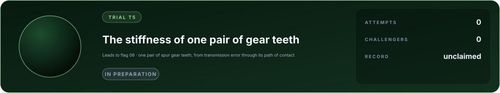

# Trial T5 · The stiffness of one pair of gear teeth

**A trial on the way to [flag 06, a metal part tearing apart](../metal-fracture/FLAG.md).** Before a simulator can say
when a loaded part fails, it must say how it deforms where parts touch: here, two gears, the most common machine
element and the reduction stage of most robot joints.

**Category:** solid mechanics and contact · **cases:** 1 hidden, 1 practice · **definition:** [flag.json](flag.json) · **rules:** [flags/README.md](../README.md)

Two identical spur gears (54 teeth, module 3.738 mm, 18 degrees, a contact ratio of 2.16) mesh slowly under load. On
one gear the teeth either side of one tooth are ground back, so that a single pair of teeth carries the whole load
through its path of contact; elsewhere two pairs share it. The transmission error, the driven gear's lag behind
perfect conjugate motion, was measured with both at two loads, and from the two the stiffness of one tooth pair was
found with the rig's bearings and shafts taken out (the reduction is in [flag.json](flag.json)).

Report, for the case's two loads:

| Output | Meaning |
|---|---|
| `tooth_pair_stiffness_half_pitch_n_per_mm_um` | the tooth pair's stiffness half a base pitch from the pitch point, N/(mm um) |
| `tooth_pair_stiffness_pitch_point_n_per_mm_um` | the same at the pitch point |

Practice case (public answer): loads 26 and 520 N/mm, 12.93 and 14.25 N/(mm um).

Why it is hard: a tooth pair's deflection is bending and shear of two teeth, the give of the gear bodies under them,
and the flattening of the contact, a strip a few tenths of a millimetre wide on a curved flank; each part is a few
micrometres, and the quantity asked is the difference between two configurations of the same rig, so a model must get
every part right, not their sum. Crowning and the contact's flattening make it depend on the load.

The source names itself in its numbers; a reference model and its assumptions are in
[docs/lab/mechanism.md](../../docs/lab/mechanism.md). The commitment of the sealed answers is in flag.json.

## Leaderboard

<!-- board:begin -->

**Attempts** 0 · **Challengers** 0 · **Record** none yet · **First clear** still to be won

> **Unclaimed, and opening soon.** This flag is in preparation: its board opens when its cases are published and its answers sealed. The first name written here stays in its history for good.

<!-- board:end -->
