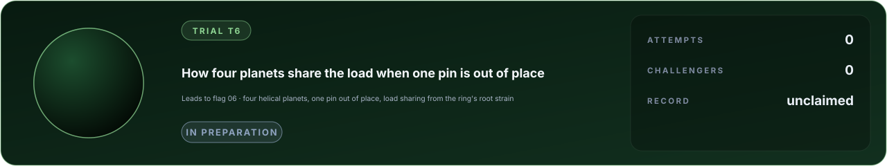

# Trial T6 · How four planets share the load when one pin is out of place

**A trial on the way to [flag 06, a metal part tearing apart](../metal-fracture/FLAG.md).** A planetary stage, the
reduction of most robot joints and of wind turbines, divides its torque among its planets only if every part is where
the drawing puts it. A carrier hole a few hundredths of a millimetre out of place gives one pair of planets far more
than its share, and the gear that fails first is the one that carried it.

**Category:** solid mechanics and contact · **cases:** 8 hidden, 1 practice · **definition:** [flag.json](flag.json) · **rules:** [flags/README.md](../README.md)

A helical planetary set (sun 73, four planets 26, ring 125 teeth, normal module 1.81 mm, helix 13.12 degrees) runs
slowly on a floating sun, its ring held in splines, its carrier the output. The carrier's hole for planet 1 is 35 or 70
micrometres out of place along the circumference, so that planet 1 leads into mesh. Strain gauges in the ring's tooth
roots catch each planet as it passes; each planet's share of the load is its peak root strain over the sum of the four.

Report, for each case's error and sun torque:

| Output | Meaning |
|---|---|
| `overloaded_pair_share` | the mean share of planets 1 and 3, the diametral pair the error loads (1/4 when equal) |

Practice case (public answer): the same carrier run the other way, so that planet 1 lags (an error of -70 um), at
1000 N m: 0.171.

Why it is hard: the planets settle wherever the sun, the ring, their bearings and their teeth balance, so a share is
the outcome of every compliance in the stage at once (the teeth in contact, the gear bodies, the ring between its
splines, the needle bearings), set against an error a fraction of the backlash. At low torque the error rivals the
deflections, and models that are right at full load predict two planets losing contact that the rig kept loaded.

The source names itself in its numbers; a reference model, its assumptions and its comparison with the published
models of this rig are in [docs/lab/mechanism.md](../../docs/lab/mechanism.md). The commitment of the sealed answers is
in flag.json.

## Leaderboard

<!-- board:begin -->

**Attempts** 0 · **Challengers** 0 · **Record** none yet · **First clear** still to be won

> **Unclaimed, and opening soon.** This flag is in preparation: its board opens when its cases are published and its answers sealed. The first name written here stays in its history for good.

<!-- board:end -->
